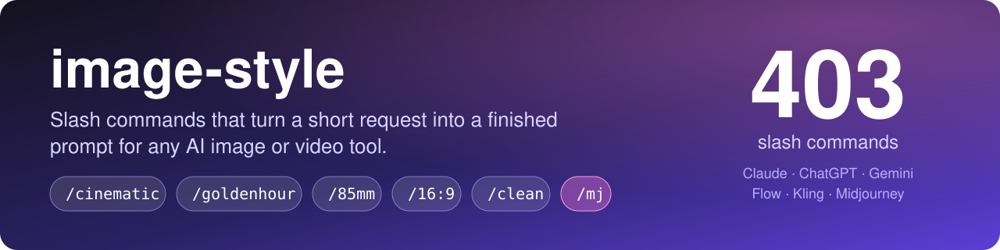
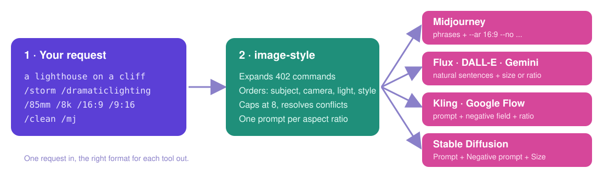
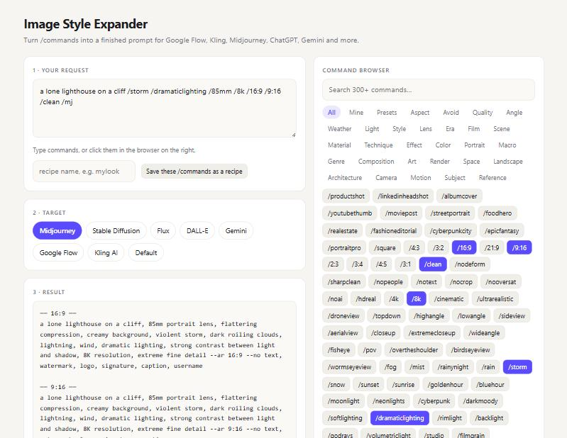
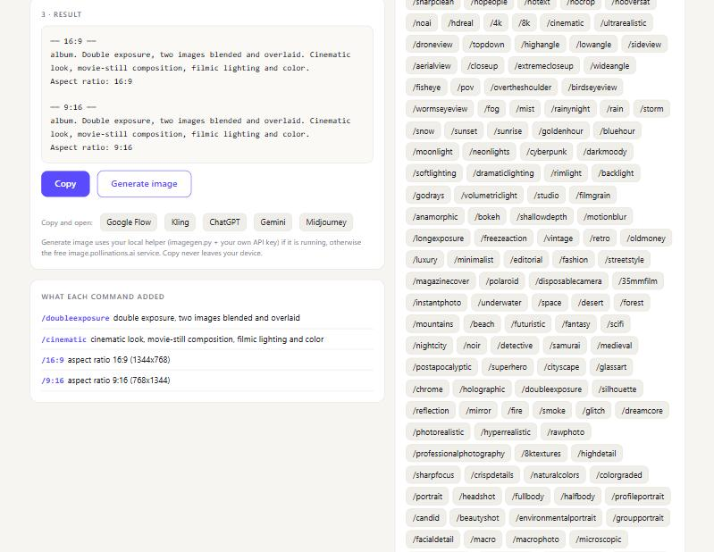
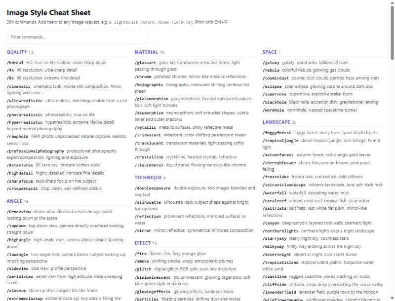

<p align="center">
  
</p>

<p align="center">
  <a href="https://github.com/geevarghesekthomas84-sys/image-style-skill/actions/workflows/test.yml"></a>
  
  
  
</p>

<p align="center">
  <a href="#-quick-start">Quick start</a> ·
  <a href="#-what-you-get">What you get</a> ·
  <a href="#-commands">Commands</a> ·
  <a href="#-install-per-platform">Install</a> ·
  <a href="#-the-expander-page">Expander page</a> ·
  <a href="#-status-what-is-tested">Status</a>
</p>

---

## ⚡ Quick start

Add commands to any image request:

```text
a lone lighthouse on a cliff /storm /dramaticlighting /85mm /8k /16:9 /9:16 /clean /mj
```

You get one finished prompt per ratio, in Midjourney's format:

```text
── 16:9 ──
a lone lighthouse on a cliff, 85mm portrait lens, flattering compression, creamy background,
violent storm, dark roiling clouds, lightning, wind, dramatic lighting, strong contrast between
light and shadow, 8K resolution, extreme fine detail --ar 16:9 --no text, watermark, logo,
signature, caption, username

── 9:16 ──
(same prompt) --ar 9:16 --no text, watermark, logo, signature, caption, username
```

Swap `/mj` for `/kling`, `/flux`, `/dalle`, `/gemini`, `/sd` or `/flow` and the same request comes out in that tool's style.
No slashes needed either: *"Create me a cinematic album double exposure, size 16:9 and 9:16"* works.

<p align="center">
  
</p>

## ✨ What you get

| | |
|---|---|
| 🎯 **Consistent wording** | `/goldenhour` always means the same phrase, not whatever you remember to type. |
| 🧩 **Right format per tool** | Midjourney flags, Stable Diffusion negative prompt, Kling negative field, Flux and Gemini sentences. |
| 🛡️ **Guard rails** | Max 8 style modifiers, one winner for conflicting commands (`/4k` vs `/8k`), unknown words kept as text. |
| 📐 **Many ratios, many prompts** | Ask for `16:9` and `9:16` together and get one prompt for each. |
| 🗣️ **Plain English** | Style words and ratios are recognised without slashes; filler like "create me a" is dropped. |
| 💾 **Your own recipes** | Save a bundle as `/mylook` and reuse it. Plus 12 built-in presets such as `/productshot`. |

## 🧰 Commands

384 in total. Browse them all in the [cheat sheet](#-cheat-sheet).

| Group | Count | Examples |
|---|---:|---|
| Style | 288 | `/cinematic` `/goldenhour` `/droneview` `/chiaroscuro` `/oilpainting` `/cyberpunk` |
| Camera and lens | 13 | `/85mm` `/f1.4` `/tiltshift` `/macrolens` |
| Video motion | 10 | `/dolly` `/orbit` `/handheld` `/slowmotion` |
| Subject controls | 29 | `/age30s` `/smile` `/walking` `/suit` `/longhair` |
| Reference images | 6 | `/sameface` `/samestyle` `/samepose` |
| Aspect ratios | 10 | `/16:9` `/9:16` `/square` `/4:5` (also `/16x9`) |
| Avoid-lists | 8 | `/clean` `/nodeform` `/nopeople` `/notext` |
| Presets | 12 | `/productshot` `/linkedinheadshot` `/moviepost` `/youtubethumb` `/albumcover` |
| Target tools | 8 | `/mj` `/sd` `/flux` `/dalle` `/gemini` `/flow` `/kling` `/generic` |

<details>
<summary><b>The rules it follows</b></summary>

- Order: subject, then angle, camera, light, style, quality last.
- At most **8** style modifiers (reference commands do not count). Extras are dropped, quality first.
- **One winner per slot**, the last one given: resolution, realism, focal length, aperture, age, expression, pose, gaze, hair length.
- Several ratios in one request produce one prompt per ratio.
- Unknown `/words` are kept as plain text and reported.
- Video-only commands (`/dolly`, `/orbit`...) are ignored for still images, and the reply says so.
- Reference commands need an image you own or have permission to use.

</details>

<details>
<summary><b>Presets</b></summary>

| Preset | Bundle | Default ratio |
|---|---|---|
| `/productshot` | product photography, studio, soft light, shallow depth, 85mm, sharp, clean | 1:1 |
| `/linkedinheadshot` | headshot, studio, soft light, 85mm, f1.4, natural colors, clean | 4:5 |
| `/albumcover` | cinematic, dramatic light, centered, film grain, color graded | 1:1 |
| `/youtubethumb` | close-up, dramatic light, high contrast, vibrant, sharp | 16:9 |
| `/moviepost` | cinematic, dramatic light, anamorphic, teal and orange, film grain | 2:3 |
| `/streetportrait` | street photography, candid, 35mm, golden hour, film grain | 3:2 |
| `/foodhero` | food photography, macro lens, window light, soft light, shallow depth | 4:5 |
| `/realestate` | real-estate photography, 14mm, window light, high detail | 16:9 |
| `/fashioneditorial` | fashion, editorial, dramatic light, 85mm, color graded | 4:5 |
| `/cyberpunkcity` | cyberpunk, night city, rainy night, neon, anamorphic | 21:9 |
| `/epicfantasy` | fantasy, matte painting, god rays, wide angle, high detail | 16:9 |
| `/portraitpro` | portrait, 85mm, f1.4, soft light, bokeh, natural colors | 3:4 |

Your own ratio always overrides a preset's default.

</details>

## 📦 Install per platform

Everything is pre-built in [`dist/`](dist). Pick your tool:

| Tool | What to use | How |
|---|---|---|
| **Claude Code** (plugin) | `dist/marketplace` | `claude plugin marketplace add ./dist/marketplace` then `claude plugin install image-style@image-style-market` |
| **Claude Code** (skill only) | `dist/image-style/` | Copy the folder to `~/.claude/skills/image-style/` |
| **Claude.ai** | `dist/platforms/claude-ai/image-style.zip` | Settings → Capabilities → Skills → Upload skill |
| **ChatGPT** | `dist/platforms/chatgpt/` | Create a Custom GPT. Paste `instructions.txt`, upload `image-style-knowledge.md`, enable Image Generation. No GPT access? Paste `custom-instructions-short.txt` into Custom instructions. |
| **Gemini** | `dist/platforms/gemini/` | Create a Gem. Paste `instructions.txt`, add `image-style-knowledge.md` as knowledge. |
| **Google Flow, Kling, anything else** | `dist/platforms/flow-kling-anywhere/expander.html` | Open in a browser (works offline). Type, pick the tool, copy. |

Plugin commands are namespaced (`/image-style:goldenhour a quiet harbor`). The skill also understands bare tokens in normal messages.
Claude.ai has no image generator, so it returns the final prompt for you to paste.

## 💻 The expander page

Google Flow and Kling have no skill or plugin system, so there is a single offline web page that does the same job.



It includes a searchable command browser (click to add), one-click copy, and a panel showing exactly what each command added:



Also in the page: **Copy and open** buttons (Flow, Kling, ChatGPT, Gemini, Midjourney) and **your own saved recipes**.

<details>
<summary><b>Save your own recipes</b></summary>

Type your usual commands, give them a name (for example `mylook`) and click *Save these /commands as a recipe*.
Then `/mylook` works like any built-in command and shows under the **Mine** tab, with a delete button.
Recipes are stored in your browser only. Open the page through `http://127.0.0.1:8787/app` (run `python imagegen.py`) so the browser keeps them reliably; pages opened as plain files may not keep saved data.

</details>

<details>
<summary><b>Generate image with your own API key (optional)</b></summary>

The **Generate image** button tries your own API first, then a free third-party service (often rate-limited).
Your key never goes into the web page: a small local helper holds it.

```powershell
$env:OPENAI_API_KEY = "sk-..."      # and/or $env:GEMINI_API_KEY = "..."
python imagegen.py
```

Then open <http://127.0.0.1:8787/app> and click Generate image. Images are billed to your provider account.
Provider model names change often. Override with `OPENAI_IMAGE_MODEL` (default `gpt-image-2`) or `GEMINI_IMAGE_MODEL` (default `gemini-3.1-flash-image`) if one is rejected. Google Imagen has been shut down.

</details>

## 📋 Cheat sheet

[`dist/cheatsheet.html`](dist/cheatsheet.html) lists every command with its wording. Searchable, and prints cleanly (Ctrl+P).



## 🔧 Edit and rebuild

Data lives in [`src/`](src):

| File | Format |
|---|---|
| `modifiers.txt` | `name\|category\|phrase` |
| `aspect.txt` | `name\|ratio\|pixels\|note` (note may list `aliases: ...`) |
| `negatives.txt` | `name\|terms to avoid` |
| `models.txt` | `name\|label\|formatting rules` |
| `presets.txt` | `name\|label\|tokens\|default ratio` |

```bash
python build.py            # regenerate dist/
python test.py             # names, presets, outputs, page script
python run_claude_tests.py # end-to-end through `claude -p` (needs a signed-in CLI)
```

Names are lowercase `a-z`, `0-9` and `.` only, and must be unique across all files.
Bump `VERSION` in `build.py` after changes so Claude Code sees the plugin update.
GitHub Actions runs `build.py` and `test.py` on every push.

## ✅ Status: what is tested

| Area | State |
|---|---|
| Data, build, plugin validation, page script | Tested automatically on every push |
| Expander page (parsing, ratios, presets, recipes, cap, copy) | Tested by hand in a browser |
| `imagegen.py` | Checked against mock OpenAI and Gemini servers only, **not yet with a real key** |
| Claude.ai, ChatGPT and Gemini uploads | **Not yet tested in the real apps** |
| Output formats for Flow, Kling, Midjourney, Flux | Written from general knowledge, **not benchmarked**. Please report outputs that look wrong. |

No command names a living artist or studio. `test.py` enforces a small blocklist.

## 📄 License

[MIT](LICENSE)
