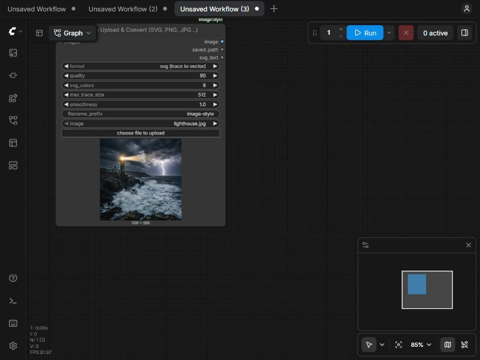

# ComfyUI-ImageStyle

Type short `/commands` in a ComfyUI node and get a full positive prompt, a matching negative prompt and an image size.

```
a lone lighthouse on a cliff /storm /dramaticlighting /24mm /16:9 /clean
```

becomes

| Output | Value |
|---|---|
| positive | `a lone lighthouse on a cliff, wide 24mm field of view, environmental context with natural perspective, violent storm, dark roiling clouds, lightning, wind, dramatic lighting, strong contrast between light and shadow` |
| negative | `lowres, blurry, bad anatomy, watermark, text, logo, signature, caption, username` |
| width, height | `1344`, `768` |
| report | one line per command used, dropped (conflicts, over the 8-modifier limit) or unknown |

The node only writes text and numbers. It does not load a model or make images itself.

## Install

1. Copy the `ComfyUI-ImageStyle` folder into ComfyUI's `custom_nodes` folder
   (or unzip `ComfyUI-ImageStyle.zip` there). ComfyUI Desktop: `<install folder>/ComfyUI/custom_nodes`.
2. Restart ComfyUI.
3. Right-click the canvas, **Add Node, image-style, Image Style Prompt**.

No extra Python packages are needed.

## The nodes

**Image Style Prompt**: one request, one prompt, one size.

| Input | What it does |
|---|---|
| `request` | Your text with `/commands`, for example `/storm /85mm /9:16 /clean`. |
| `style` | `keywords` (comma-separated, for SD, SDXL, Pony) or `sentences` (plain sentences, for Flux, SD3, Qwen-Image). |
| `default_ratio` | Used only when the request has no ratio. |
| `megapixels` | Scales the size. `1.0` is about 1 MP (SDXL, Flux). Use about `0.25` to `0.5` for SD 1.5. At `1.0` you get the project's table sizes (multiples of 32); other values are scaled to multiples of 64. |
| `ratio_pick` | If the request lists several ratios, which one to use (0 is the first). |
| `extra_negative` | Extra terms appended to the negative prompt. |
| `add_base_negative` | Adds `lowres, blurry, bad anatomy, watermark` (keywords style only). |
| `fold_negatives_into_prompt` | Sentences style only: appends "Clean image without ..." to the prompt, because Flux ignores negatives. |
| `plain_english` | Also recognises style words and ratios written without slashes. Off by default, so your own words are never removed. |

Outputs: `positive`, `negative`, `width`, `height`, `report`.

**Image Style Prompt (all ratios)**: the same, but if you ask for `/16:9 /9:16` it returns one item per ratio, so the nodes after it run once for each.

## Upload & Convert node (SVG, PNG, JPG, WebP, BMP, TIFF, GIF)

**Image Style Upload & Convert** has an **upload button** (choose a file from your computer) and saves the picture in the format you pick. You can also connect an `IMAGE` from your workflow to `images` instead, for example the output of a sampler. If you connect one, the uploaded file is ignored.

| Setting | What it does |
|---|---|
| `format` | `png`, `jpg`, `webp`, `bmp`, `tiff`, `gif`, `svg (trace to vector)` or `svg (embed image)`. |
| `quality` | For `jpg` and `webp`. |
| `svg_colors` | How many flat colours the tracer uses (2 to 32). More colours give more detail and a bigger file. |
| `max_trace_size` | Longest side, in pixels, used while tracing (64 to 1024). Bigger is slower. |
| `smoothness` | Higher values give simpler, smoother outlines. |
| `filename_prefix` | Files are saved in ComfyUI's `output` folder, numbered like `image-style_00001_.svg`. |

Outputs: `image` (passes the picture on), `saved_path`, and `svg_text` (the SVG source, empty for other formats).

**Be clear about what SVG means here**
- `svg (trace to vector)` turns the picture into flat-colour vector paths. It is good for **logos, icons, flat illustrations and stylised art**. **Photos become a posterised look** (flat colour bands), not a photographic vector. It takes about a second for a 512 px image. Transparency is flattened onto white.
- `svg (embed image)` only wraps the picture inside an SVG file. It scales in a viewer but is **not** vector artwork.
- Files are only written into ComfyUI's output folder. A file name that tries to climb out of it is refused.



## Example workflow

`example_workflows/image-style-z-image-turbo.json` is a complete Z-Image-Turbo workflow with the Image Style node already wired in (prompt into CLIP Text Encode, width and height into Empty SD3 Latent Image, report into Preview Any). Drag the file onto the ComfyUI canvas, or find it under **Templates** (custom node templates) after a restart. Check the three model names in the loader nodes match your files (`z_image_turbo_bf16`, `qwen_3_4b`, `ae`).

Two more workflows in the same folder:
- `image-style-upload-to-svg.json`: Upload & Convert node on its own. Press Run to try it on the bundled sample picture (`image-style-sample.png`, copied into ComfyUI's `input` folder the first time the node loads), or click **choose file to upload** to use your own. The SVG lands in `ComfyUI/output` and the path shows in a preview node. Press **Download last result** on the node to save the file(s) from the last run through your browser. When an IMAGE is connected to `images`, it is used instead of the picker.
- `image-style-z-image-turbo-svg.json`: the Z-Image-Turbo workflow above plus a step that also saves every generated picture as SVG (traced, flat colours; photos come out posterised).

## Command helper in the request box

Click into the `request` box of an Image Style node and type `/`:

- **Autocomplete**: a list of matching commands appears with a short description. Use the arrow keys, then **Tab** or **Enter** to insert one (or click it). **Esc** closes the list.
- **Live preview**: under the box you see the positive prompt, negative prompt, size and the report, updated as you type. It asks the node's own Python code, so what you see is what the node will output.

It appears only in the `request` box, not in other text boxes, and hides when you click away. It needs a ComfyUI restart after installing, and does nothing to your graph.

## Wiring it up

- `positive` and `negative` go into your **CLIP Text Encode** nodes. In newer frontends you can drag the link straight onto the text box; in older ones, right-click the text widget and choose **Convert to input** first.
- `width` and `height` go into **Empty Latent Image**.
- `report` can go to **Preview Any** to see what each command did.

## Commands

403 commands, including styles, camera and lens (`/85mm`, `/f1.4`), subject controls, couple and wedding, avoid-lists (`/clean`, `/nodeform`), aspect ratios (`/16:9`, `/9:16`, `/4:5`) and presets (`/productshot`, `/portraitpro`). The full list is in the [cheat sheet](https://github.com/geevarghesekthomas84-sys/image-style-skill#-cheat-sheet) of the main project. Target-tool commands such as `/mj` or `/kling` are accepted but ignored here, because this node chooses its format with `style`.

## Tested

- Loads and runs in **ComfyUI 0.39.0** (CPU mode): both nodes register, run, and their width and height reach Empty Latent Image and Empty Image (sizes read back as 1344x768, 768x1344, 1024x1024, 896x1120). The all-ratios node ran four times for four ratios. Invalid input is rejected by ComfyUI.
- The browser helper was tried with real keyboard input in ComfyUI's own interface (frontend 1.55.14): the list appears, the arrow keys and Tab insert a command and ComfyUI stores the new text, the preview updates, and it stays away from other text boxes.
- **Upload & Convert** was run in ComfyUI 0.39.0: an image uploaded through ComfyUI's own upload endpoint was saved in all 8 formats, a batch of 2 gave 2 files, the image passed on to the next node, a missing image gave a clear error, and a path-escape file name was refused. The node shows the upload button and a preview on the canvas.
- 28 unit tests, including exact agreement with the project's web page on 28 recorded requests (`python tests/test_core.py`).
- **Not tested:** older ComfyUI versions, other operating systems, other browsers, and combining it with other custom node packs.

## License

MIT
